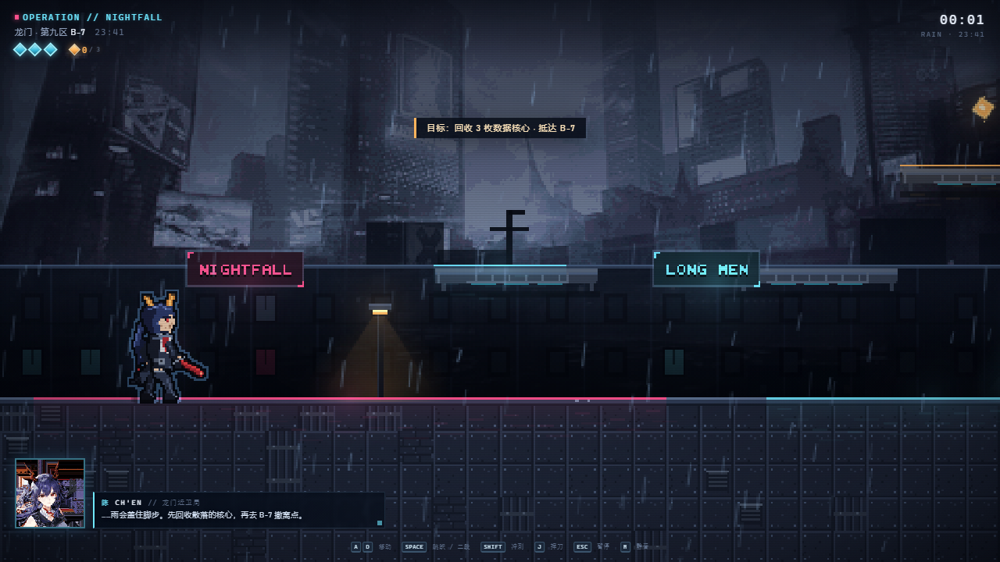
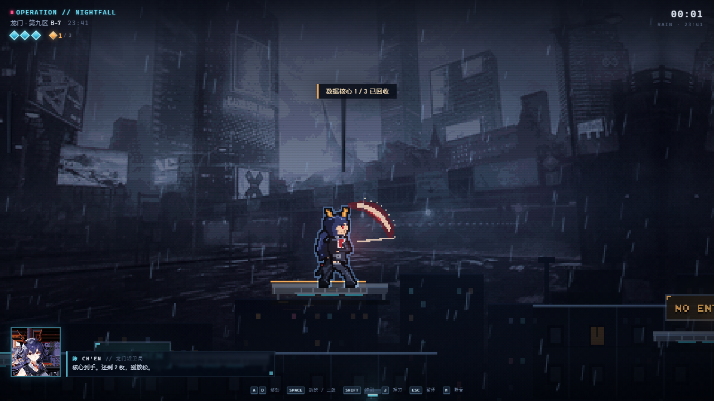
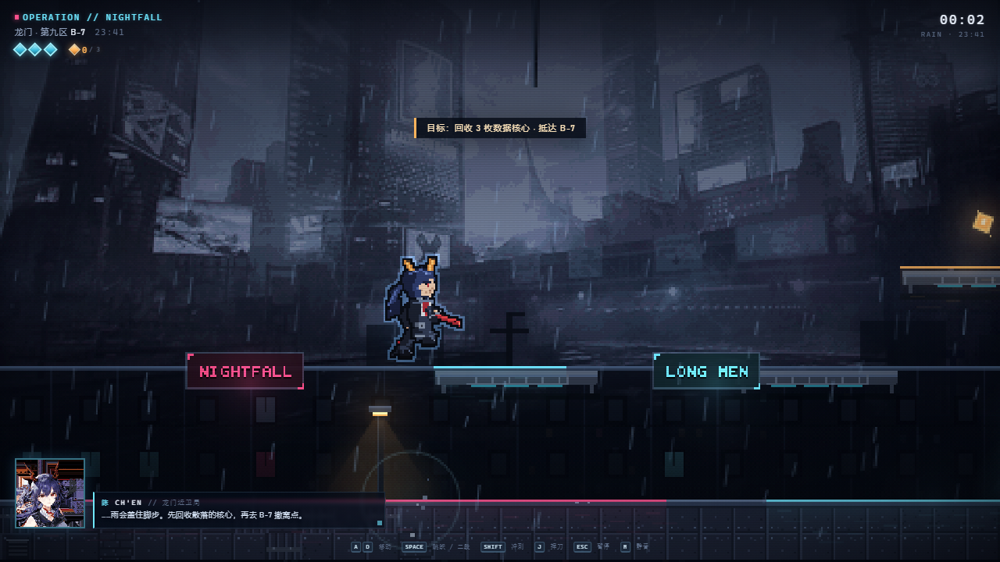
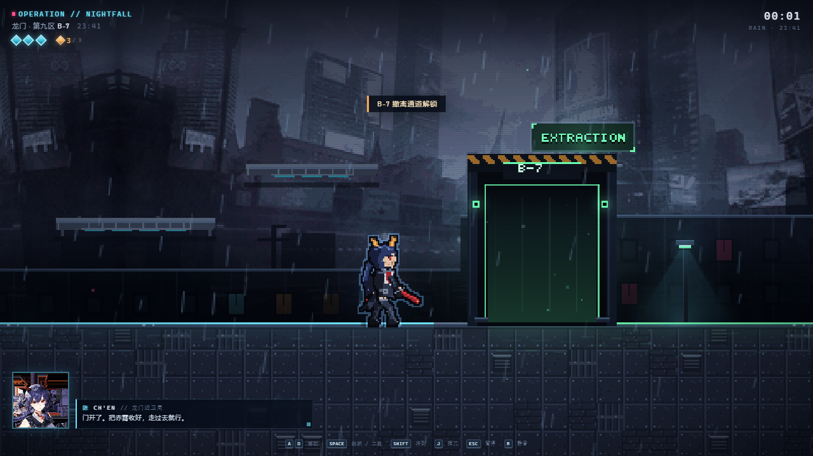
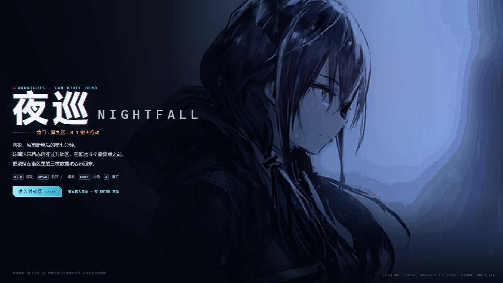
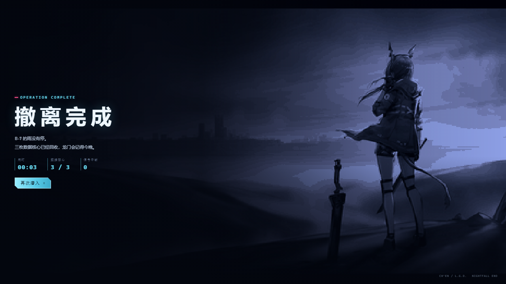

# 夜巡 NIGHTFALL · 龙门 B-7

一个用原生 Canvas 写的横版像素动作小 Demo。角色原型是《明日方舟》的陈（陈晖洁），
素材来自明日方舟里：角色立绘被处理成像素角色与通讯头像，雨夜都市背景被重构成
三层视差卷轴。

- 分辨率：480 × 270（整数/像素化放大）
- 玩法：跑、跳、二段跳、冲刺、挥刀、收集 3 枚数据核心、检查点、B-7 撤离门
- 类型：类银河恶魔城的小关卡（可探索下层巷道与高空平台）

## 怎么玩

1. 双击 `启动游戏.bat`，或直接双击 `index.html`。
2. 标题画面按 `Enter` / `空格`（或点「进入封锁区」）。
3. 建议使用 Edge / Chrome，键盘操作，声音在第一次操作后开启。

| 按键 | 功能 |
| --- | --- |
| `A` / `D` / `←` / `→` | 左右移动 |
| `Space` / `K` / `W` | 跳跃；空中再按一次二段跳 |
| `Shift` / `L` | 冲刺（落地刷新，空中可用一次） |
| `J` / `X` | 挥刀 |
| `Esc` / `P` | 暂停 / 继续 |
| `M` | 静音 |
| `R` | 重新开始整局 |

## 实机画面

| 雨夜街区 | 赤霄挥砍 |
| --- | --- |
|  |  |

| 跳跃 | B-7 闸门 |
| --- | --- |
|  |  |

| 标题 | 撤离结算 |
| --- | --- |
|  |  |

## 目标

- 收集散落的三枚数据核心：起始街区高台、下层巷道、高空平台。
- 抵达 B-7 撤离门。核心不足时门不会打开；集齐后靠近闸门会自动解锁。
- 穿过闸门即触发撤离结算（显示用时、核心数、死亡次数）。

## 关于按键响应

- 跳跃、挥刀、冲刺都在**键盘事件发生时立即写入缓冲**，不依赖“这一帧有没有跑物理”，
  所以快速短按、连按、以及受击顿帧期间按下的键都不会被吞。
- 物理以 120Hz 子步进运行，输入在 keydown 时即进入缓冲，下一个物理步（8.3ms）就生效。
- 短按跳跃有 60ms 的最低保底上升时间，不会因为松键太快变成“原地没动”。
- 冲刺方向会在起手瞬间读取当前方向键，同时按方向和 `Shift` 不会冲反。
- 如果按键完全没反应：确认浏览器窗口处于焦点、输入法切到英文（中文输入法可能拦截
  单键），再点一下游戏画面即可。

## 手感与实现

- 固定 120Hz 物理步进 + 可变刷新率渲染；重力 1450、跳跃初速 455、冲刺 320。
- 郊狼时间 0.1s、跳跃缓冲 0.15s、松开跳跃键截断上升、空中冲刺。
- 瓦片 AABB 碰撞；单向平台支持从下方穿过、下落时踩住。
- 相机带前瞻、垂直偏置、平滑跟随与受击震屏；命中时短暂顿帧。
- 三层视差：风暴远景 / 霓虹楼群 / 近景剪影，全部由原始参考图重新调色、像素化而来。
- 雨、雾、闪电、湿地面反光、霓虹辉光、角色蓝色轮廓光均为运行时绘制。
- 音频全部 WebAudio 程序化合成：雨声、低频氛围 pad、跳跃/冲刺/挥刀/受伤/拾取/闸门音效。

## 目录

```
方舟夜巡/
├─ index.html          页面与 HUD / 标题 / 结局 UI
├─ style.css           像素 UI、标题排版、扫描线、结局画面
├─ 启动游戏.bat         双击即玩
├─ js/
│  ├─ audio.js         程序化环境音与音效
│  ├─ level.js         关卡数据、图块世界、霓虹招牌位图字体
│  └─ game.js          物理、实体、相机、渲染、输入、状态机
├─ assets/             像素素材（由 tools 脚本生成）
│  ├─ chen_sheet.png   陈的 16 帧精灵表（56×56）
│  ├─ chen_rim.png     轮廓光遮罩
│  ├─ slash_0..3.png   赤霄挥砍月牙
│  ├─ tiles.png        16×16 图块集
│  ├─ bg_far/mid/near.png  视差背景层
│  ├─ title_bg.png     标题背景（侧颜）
│  ├─ ending_bg.png    结局背景（背影）
│  └─ portrait.png     通讯头像
├─ screenshots/        实机截图
└─ tools/              素材生成与自动化验证脚本（可选）
```

## 素材与版权

- 角色立绘、场景参考图来自工作区 `方舟冒险/` 中用户提供的素材；本 Demo 仅作学习、
  个人练习与技术演示，非商业用途。
- 角色「陈 / Ch'en」及相关美术归上海鹰角网络（Hypergryph）所有。
- 代码、像素化流程与程序化音频为本项目生成。

## 可选：重新生成素材 / 验证

需要本机 Python（Pillow、numpy）与 Node.js + Edge：

```powershell
python tools/gen_bg.py      # 背景、标题、结局、头像
python tools/gen_char.py    # 陈的精灵表、轮廓光、挥砍特效
python tools/gen_tiles.py   # 图块集
node tools/verify.mjs       # 无头浏览器自动化烟测（22 项）
```

`verify.mjs` 会启动一个本地无头 Edge 实例，加载 `index.html`，检查移动、跳跃、二段跳、
冲刺、拾取、攻击、受伤、检查点复活、闸门逻辑、结局与暂停，并把截图写到 `tools/shots/`。
